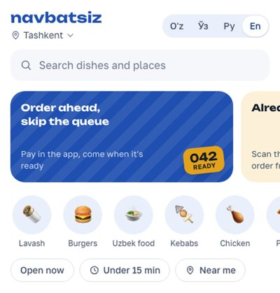
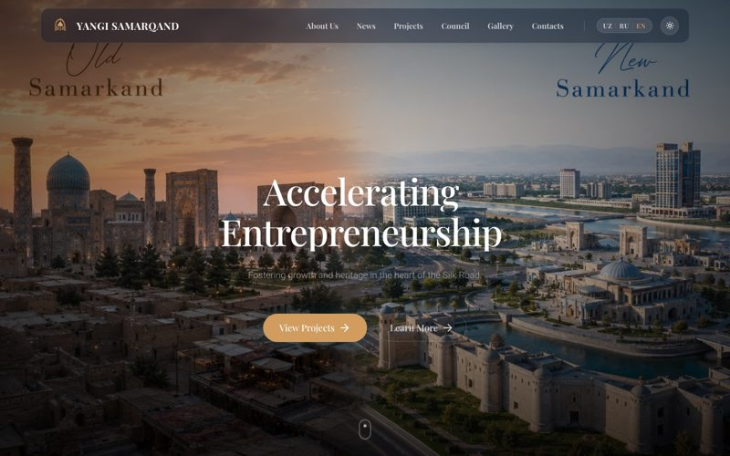

## Hi, I'm Badriddin 👋

**Fullstack developer** — TypeScript · React / Next.js · Node.js · Django.
I build products end to end: interface, API, database, Telegram bots, deployment.
Almost 2 years of commercial experience at Osiyo Tech; Computer Science student in Samarkand.

📍 Samarkand, Uzbekistan · 🌍 Open to remote work · 🗣 Uzbek, Russian, English (B2)

### Stack

### Featured work

<table>
<tr>
<td width="62%" valign="top">

#### 🍽 Navbatsiz — order ahead, skip the queue
**[navbatsiz.app](https://navbatsiz.app)** · private repository

A food pre-order and table-ordering platform for cafés in Uzbekistan. Guests order and pay
ahead and pick up by number, or scan the QR code on the table; staff work from a Telegram bot,
owners from a web cabinet.

- **Guest app** that also runs as a Telegram Mini App: catalog, cart, live order status,
  SMS sign-in, one-time pickup QR, an open bill at the table, 4 languages
- **Bookings** on a floor plan of the hall; waiter shifts, zones and order routing
- **Telegram bot** for staff: order cards that update for everyone, waiter calls, menu import
  from text, Excel or a photo of a paper menu (Claude API)
- **Owner cabinet**: menu, tables with printable QR signs, roles and permissions, reports with
  Excel export, an action log, feature plans per venue
- Kitchen display and TV board, Payme / Click payments and refunds
- **3,400+ backend tests** on PostgreSQL, CI/CD with GitHub Actions and a health check,
  encrypted nightly backups
- **Next.js 16 · React 19 · Django 5 / DRF · PostgreSQL · Docker Compose · Cloudflare · Vercel**

</td>
<td width="38%" align="center">

</td>
</tr>
</table>

| Project | What it is | Stack |
|---|---|---|
| [**Maktab Infra**](https://github.com/baxr1lloev/maktab-info) | Telegram Mini App + bot for reporting school infrastructure problems: HMAC-verified requests, photo pipeline, moderation and before/after posts in Telegram | Next.js 16 · Prisma · PostgreSQL · Telegraf |
| [**MAX Chat**](https://github.com/baxr1lloev/green-api-max-chat) · [live](https://baxr1lloev-max-chat.vercel.app) | Web chat that sends and receives messages in the MAX messenger through GREEN-API, desktop and mobile layouts | React 19 · TypeScript · Vite · Vitest |
| [**Yangi Samarqand**](https://github.com/baxr1lloev/yangisamarkand) · [live](https://yangisamarkand.vercel.app) | Website of the Center for Entrepreneurship Development in Samarkand, 3 languages, content managed from Django admin, CI/CD to Azure | Next.js 16 · Django REST · GSAP |
| [**Outland Travel**](https://github.com/baxr1lloev/plane_outlandtravel) · [live](https://plane-ruby-five.vercel.app) | Airline landing with a 192-frame scroll-driven canvas animation | Next.js 16 · TypeScript · GSAP · Framer Motion |
| [**Million Motors**](https://github.com/baxr1lloev/millionmotors) · [live](https://millionmotors.vercel.app) | Landing page for a car and EV dealership | Next.js · Tailwind CSS · Framer Motion |

### Certificates

- [**GREEN-API Certified Developer**](https://green-api.com/certificates/developer/df43c968e3bc47b4.pdf) —
  integration and chatbot development on GREEN-API · No. 2244346, October 2026
