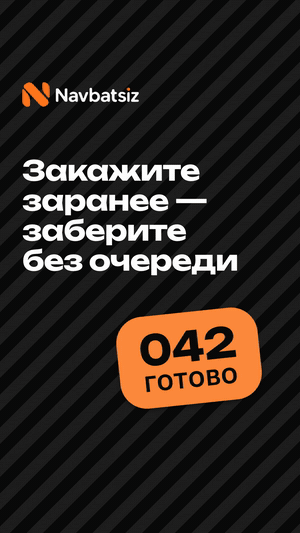
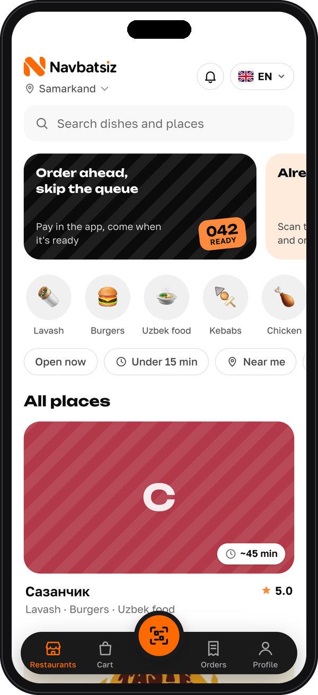
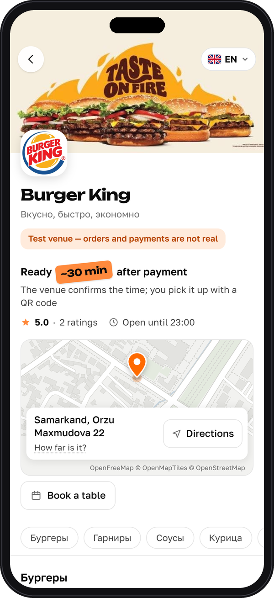
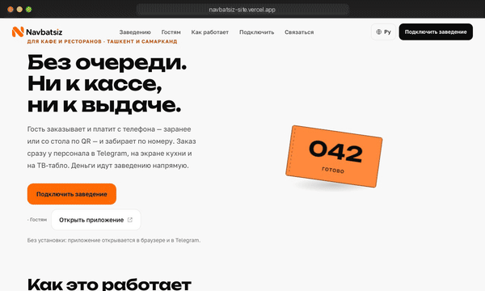
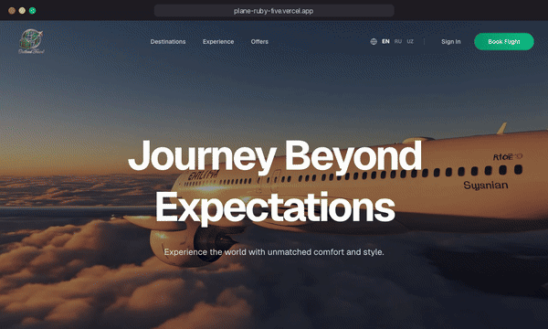
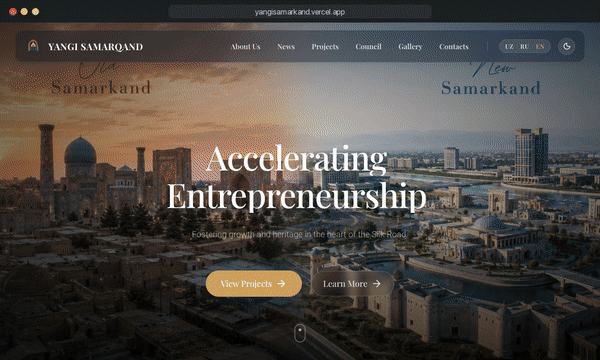
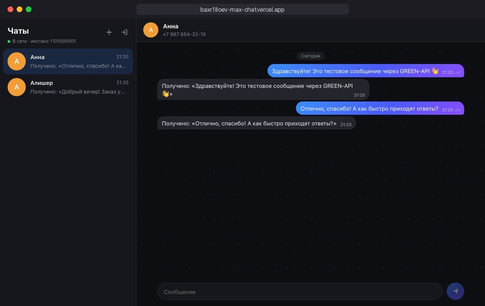
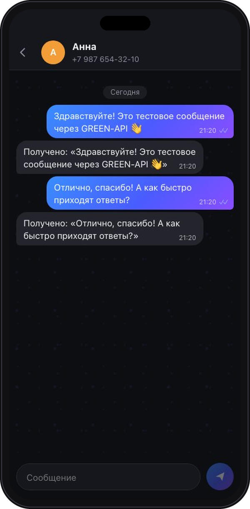

  

  
  
  

### ⚡ Why work with me

- **I ship whole products, not just tickets.** Navbatsiz below is mine end to end: guest app, staff Telegram bot,
  owner cabinet, payments, server, backups and CI/CD.
- **I write tested code.** 3,400+ backend tests on PostgreSQL; every push to `main` passes CI and a health check before it goes live.
- **I handle money and concurrency carefully.** Payme and Click payments with refunds, orders guarded by row and advisory locks.
- **I build for real people in real languages.** Interfaces in Uzbek (Latin and Cyrillic), Russian and English.
- Almost 2 years of commercial experience at Osiyo Tech · Computer Science student · open to remote work.

---

## 🍽 Navbatsiz — order ahead, skip the queue

<table>
<tr>
<td width="34%" align="center" valign="top">
  
</td>
<td width="66%" valign="top">

**[navbatsiz.app](https://navbatsiz.app)** · [company site](https://navbatsiz-site.vercel.app) · private repository

A food pre-order and table-ordering platform for cafés in Uzbekistan. Guests order and pay
from their phone and pick up by number, or scan the QR code on the table and order from their seat.
Staff get every order in Telegram, on the kitchen screen and on a TV board.

- 📱 **Guest app**, also a Telegram Mini App: catalog, cart, live order status, SMS sign-in,
  one-time pickup QR, an open bill at the table, 4 languages
- 🪑 **Bookings** on a floor plan of the hall; waiter shifts, zones and order routing
- 🤖 **Telegram bot** for staff: live order cards, waiter calls, menu import from text, Excel
  or a photo of a paper menu (Claude API)
- 📊 **Owner cabinet**: menu, printable QR signs, roles and permissions, reports with Excel
  export, an action log, feature plans per venue
- 💳 Payme / Click payments and refunds · 🍳 kitchen display · 📺 TV board
- 🛡 3,400+ tests · CI/CD on GitHub Actions · encrypted nightly backups

`Next.js 16` `React 19` `TypeScript` `Django 5 / DRF` `PostgreSQL` `Docker Compose` `Caddy` `Cloudflare` `Vercel`

</td>
</tr>
</table>

<table>
<tr>
<td width="25%" align="center" valign="top"> Places, categories, filters</td>
<td width="25%" align="center" valign="top"> Venue: ready time, map, booking, menu</td>
<td width="50%" align="center" valign="top"> Company website: Next.js 16, Motion, three.js</td>
</tr>
</table>

---

## 🚀 More work

<table>
<tr>
<td width="50%" align="center" valign="top">

</td>
<td width="50%" valign="top">

#### 🏎 BMW M4 — scroll teardown
**[Open and scroll](https://baxr1lloev.github.io/m4-s58-teardown/)** · [code](https://github.com/baxr1lloev/m4-s58-teardown)

A black M4 Competition (G82) in a dark studio. Scrolling dissolves the body into x-ray; the S58
inside runs from its real dimensions (bore 84 × stroke 90 mm, firing order 1‑5‑3‑6‑2‑4), then
lifts out of the bay and comes apart.

- The scroll is the timeline: one pure `render(t)` drives camera, dissolve and explode
- GLSL dissolve and fresnel x-ray over a glTF model; the engine is procedural, posed from one crank angle
- **three.js · GLSL · glTF / meshopt · GitHub Pages**

</td>
</tr>
</table>

<table>
<tr>
<td width="50%" valign="top">
  

**✈️ Outland Travel** — premium airline landing with a 192-frame scroll-driven canvas animation. 
`Next.js 16` `TypeScript` `GSAP` `Framer Motion` 
[Live](https://plane-ruby-five.vercel.app) · [Code](https://github.com/baxr1lloev/plane_outlandtravel)
</td>
<td width="50%" valign="top">
  

**🏛 Yangi Samarqand** — website of the Center for Entrepreneurship Development in Samarkand:
3 languages, content from Django admin, CI/CD to Azure. 
`Next.js 16` `React 19` `Django REST` `GSAP` 
[Live](https://yangisamarkand.vercel.app) · [Code](https://github.com/baxr1lloev/yangisamarkand)
</td>
</tr>
<tr>
<td width="50%" valign="top">
  
  

**💬 MAX Chat** — web chat that sends and receives MAX messenger messages through GREEN-API,
desktop and mobile layouts, covered by tests. 
`React 19` `TypeScript` `Vite` `Vitest` 
[Live](https://baxr1lloev-max-chat.vercel.app) · [Code](https://github.com/baxr1lloev/green-api-max-chat)
</td>
<td width="50%" valign="top">

**🏫 Maktab Infra** — Telegram Mini App + bot for reporting school infrastructure problems:
HMAC-verified requests, a photo pipeline, moderation and before/after posts in a Telegram channel. 
`Next.js 16` `Prisma` `PostgreSQL` `Telegraf` 
[Code](https://github.com/baxr1lloev/maktab-info)

**🚗 Million Motors** — landing page for a car and EV dealership. 
`Next.js` `Tailwind CSS` `Framer Motion` 
[Live](https://millionmotors.vercel.app) · [Code](https://github.com/baxr1lloev/millionmotors)

</td>
</tr>
</table>

---

## 🧰 Stack

## 🏅 Certificates

- [**GREEN-API Certified Developer**](https://green-api.com/certificates/developer/df43c968e3bc47b4.pdf) —
  integration and chatbot development on GREEN-API · No. 2244346, October 2026

## 📫 Let's talk

Open to remote full-time or contract work. The fastest way to reach me is
[Telegram @baxrilloev](https://t.me/baxrilloev); email works too — [bbaxrilloev@gmail.com](mailto:bbaxrilloev@gmail.com).
